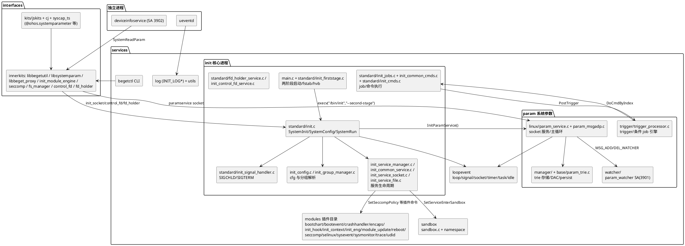

# 架构设计及约束

## 架构设计

### 设计原则

| 原则 | 描述 | 理由 |
|---|---|---|
| 单线程事件循环 | init 进程只有一个执行线程，主循环为 `SystemRun()` → `StartParamService()` → `ParamServiceStart()` → `LE_RunLoop(LE_GetDefaultLoop())`（`services/init/standard/init.c`、`services/param/linux/param_msgadp.c:143`）；信号（signalfd）、socket、定时器、trigger 队列全挂同一 epoll 循环 | PID 1 无需并发；阻塞会同时冻结服务孵化、信号回收、参数服务（`services/init`、`services/param` 目录无 `pthread_create` 命中） |
| 仅本地 socket IPC | 跨进程控制（服务启停、参数 get/set/watch、fd 代持、control-fd）全部走 `/dev/unix/socket` 下的 AF_UNIX socket | init 不持有 Binder 运行时；socket + SO_PASSCRED（ucred）即可完成权限判定 |
| 依赖单向分层 | `interfaces` → `services/init` → `services/loopevent`/`services/utils`；inner-kits 是唯一对外链接面 | loopevent/utils 是基础库，反向依赖会形成环 |
| 插件承载可选特性 | bootchart/bootevent/reboot/seccomp/selinux/sysevent/trace/udid 等为动态模块（`services/modules/` + `interfaces/innerkits/init_module_engine/`），经 hook（`InitAdd*Hook`）与命令执行器（`AddCmdExecutor`）接入 | 核心路径保持精简，产品按需裁剪 |
| 共享内存只读加速参数读 | 参数存储 mmap 于 `/dev/__parameters__`，多进程只读共享，读端无 IPC | 参数 get 是高频路径；写仍走 socket 服务端单点 |
| lite/standard 双形态 | 标准系统代码在 `services/init/standard/` 等；小型系统在 `services/init/lite/`、`services/etc_lite/`，同步执行 job、无 trigger 队列 | 两类系统资源与内核能力差异大，分支而非条件编译混排 |

### 逻辑架构

各层职责与关键源码位置：

| 层/模块 | 职责 | 核心文件 |
|---|---|---|
| 两阶段启动 | ramdisk 阶段挂必需分区、切根、签名校验、拉起第二阶段 | `services/init/main.c`、`services/init/standard/init_firststage.c`、`services/init/standard/init_mount.c`、`interfaces/innerkits/fs_manager/fstab_mount.c`、`switch_root/switch_root.c`、`libfs_hvb/fs_hvb.c`、`dm_verity/dm_verity.c` |
| init 核心 | 事件循环装配、启动顺序编排 | `services/init/standard/init.c`（`SystemInit`:240 / `SystemConfig`:457 / `SystemRun`:532） |
| cfg/分组解析 | JSON cfg 解析、import、group cfg、多分区优先级 | `services/init/init_config.c`、`services/init/init_group_manager.c` |
| 服务管理 | 服务解析/fork/权限/保活/socket | `services/init/init_service_manager.c`、`services/init/init_common_service.c`、`services/init/init_service_socket.c`、`services/init/init_service_file.c` |
| job/命令 | 命令表匹配、上下文分发、限制执行 | `services/init/init_common_cmds.c`（通用表 `g_cmdTable`:846）、`services/init/standard/init_cmds.c`（标准表 `g_cmdTable`:1307）、`services/init/standard/init_cmdexecutor.c`（插件命令） |
| 系统参数 | 存储、DAC/MAC、服务端、persist、watcher | `services/param/{manager,base,linux,adapter,trigger,watcher}/` |
| loopevent | epoll/信号/定时/流任务基础设施 | `services/loopevent/`（`loop/le_epoll.c`、`loop/le_loop.c`、`signal/le_signal.c`、`socket/le_socket.c`、`task/*`、`timer/le_timer.c`、`idle/le_idle.c`） |
| 插件 | 可选特性动态库 | `services/modules/*`，引擎在 `interfaces/innerkits/init_module_engine/` 与 `services/init/standard/init_cmdexecutor.c`、`services/init/bootstagehooker.c` |
| 沙箱 | system/chipset namespace | `services/sandbox/sandbox.c`、`sandbox_namespace.c`、json 在 `services/etc/sandbox/` |
| ueventd | 设备节点管理 | `ueventd/ueventd_main.c`、`ueventd.c`、`ueventd_socket.c`、`ueventd_device_handler.c`、`ueventd_firmware_handler.c`、`ueventd/standard/ueventd_parameter.c` |
| DeviceInfo | 设备信息 SA | `device_info/device_info_service.cpp`、`device_info_kits.cpp`、`device_info_load.cpp` |
| begetctl | CLI 调试 | `services/begetctl/`（mini shell 框架 `shell/`） |

启动顺序（`SystemConfig`，`services/init/standard/init.c`）：`InitSysAdj` → `InitServiceSpace` → INIT_GLOBAL_INIT hook → INIT_PRE_PARAM_SERVICE hook → `InitParamService`（失败 `ExecReboot("panic")`）→ `InitParseGroupCfg` → `RegisterBootStateChange` → 等 memcg → SELinux 策略加载（`PluginExecCmdByName("preLoadSelinuxPolicy")/("loadSelinuxPolicy")`，位置固定）→ `SignalInit` → `LoadSpecialParam` → INIT_PRE_PARAM_LOAD hook → `InitLoadParamFiles` → `WriteUptimeSysParam` → `SetInitPriority` → INIT_PRE_CFG_LOAD hook → `ReadConfig` → INIT_POST_CFG_LOAD hook → `IsEnableSandbox` → `PrelinkReady` → `SetRootUid` → `PostInitTriggers`（pre-init/init job → boot 服务 → post-init → normal 服务，服务按 4 个一组打包为 `boot-service:*` job）。

### 非功能设计

| 场景类别 | 方案设计 |
|---|---|
| 可靠性（服务保活） | `ServiceReap()`→`HandleServiceExit()`（`services/init/init_common_service.c`）：once 不重启；critical 在 `CRITICAL_DEFAULT_CRASH_TIME=240` 秒内 `CRITICAL_DEFAULT_CRASH_COUNT=4` 次退出则 `ExecReboot("panic")`；普通服务超限则延时（crashTime 秒）再重启；importance 仅影响优先级（standard），lite 下重要进程退出直接 `RebootSystem()` |
| 可靠性（init 自身） | 参数服务初始化失败整机 panic；crashhandler 插件（`services/modules/crashhandler/`）本地捕获 SIGSEGV/SIGBUS/SIGILL/SIGABRT/SIGSYS 打印 backtrace；watchdog 目录提供喂狗工具 |
| 并发/响应 | 单线程 + 非阻塞任务（loopevent timer/socket/idle）；长操作 fork 子进程执行（`SyncExecCommand` 超时 `SYNC_EXEC_TIMEOUT_MS=30000`）；参数读端共享内存 + commitId 原子量 + futex 等待（`services/param/base/param_base.h`） |
| 性能（启动） | 服务按 `maxServiceInJob=4` 分批并行拉起；trigger 队列 `TRIGGER_EXECUTE_QUEUE=64`、单轮 `MAX_TRIGGER_COUNT_RUN_ONCE=20`；参数空间按 label 分区（`/etc/param/ohos.para.size`） |
| 安全（进程隔离） | `SetPerms` 固定顺序：securebits 保 caps → setgid/setgroups → **seccomp（先于 setuid）** → setuid → capset/ambient caps；secon 经 selinux 插件 `setexeccon`；uid=0 且配置 caps 时 `DropCapability` 逐项收紧 capbset |
| 安全（参数访问） | DAC（`*.para.dac`：`<前缀> = user:group:mode[:type]`）+ SELinux MAC（`param_selinux.c` + `parameter_contexts`）；写控制前缀 `ohos.servicectrl.`/`ohos.ctl.start=`/`ohos.ctl.stop=`/`ohos.startup.powerctrl=` 需 DAC 放行；`const.`/`ro.`/`ohos.boot.` 只读 |
| 安全（syscall 面） | seccomp 策略文件 `services/modules/seccomp/seccomp_policy/*.seccomp.policy` 经 `scripts/generate_code_from_policy.py` 生成 `lib*_filter.z.so`，运行时 `SetSeccompPolicyWithName` dlopen + `seccomp(SECCOMP_SET_MODE_FILTER, TSYNC|LOG)`；`privileged_process.seccomp.policy` 放行高权限进程必需的高危调用 |
| 安全（沙箱） | `PrepareSandbox`：`unshare(CLONE_NEWNS)` → bind 列表逐项挂载 → `pivot_root` → `umount2(".", MNT_DETACH)`；服务 `sandbox:0/1` 控制 |
| 可观测 | `INIT_LOG*` 分模块宏（`services/log/`、`beget_ext.h`），`persist.init.debug.loglevel` 调级；bootevent 插件统计启动事件；bootchart 插件采样；control_fd 的 ACTION_DUMP 支持服务/参数/trigger/loop dump |
| 升级/恢复 | updater 模式（`InUpdaterMode()`）跳过挂载与切根；A/B 分区（`init_feature_ab_partition`，`GetBootSlots()>=2` 时 INIT_SNAPSHOT_ACTIVE hook）；EROFS overlay（`init_startup_feature_erofs_overlay`）；misc 分区写重启原因（reboot 插件 `reboot_misc.c`） |

## 架构约束

- **init 单线程**
  - **what**：`services/init`、`services/param` 代码不得引入 `pthread_create` 或长阻塞调用；耗时工作用 loopevent 的 timer/idle 异步化或 fork 执行。例外仅在独立进程：bootchart 插件采样线程（`services/modules/bootchart/bootchart.c:239`）、ueventd 参数通知线程（`ueventd/standard/ueventd_parameter.c:113`）。
  - **why**：主循环阻塞会冻结所有服务的 fork/SIGCHLD 回收/参数服务，表现为系统级卡死。
- **IPC 只用本地 socket**
  - **what**：init 侧新增服务端点必须落在 `/dev/unix/socket`（AF_UNIX），配合 SO_PASSCRED；不得引入 Binder/共享内存新通道。
  - **why**：init 无 Binder 运行时；共享面扩大将绕过现有 DAC/MAC 审计点。
- **依赖方向**
  - **what**：`services/loopevent`、`services/utils` 不得引用 `services/init` 头；服务内部头不得进 `interfaces/innerkits/include`；对外符号受 `libbegetutil.versionscript` 等三个版本脚本约束。
  - **why**：反向依赖破坏构建分层并造成符号泄漏导出。
- **SetPerms 顺序不可调整**
  - **what**：`services/init/init_common_service.c` 中 caps 保活（securebits）→ gid → seccomp → uid → caps 的顺序固定，代码注释明确 "set seccomp policy before setuid"。
  - **why**：先 setuid 会丢失部分能力或让 seccomp 无法按预期身份装载，属于安全回归。
- **参数长度与错误码 ABI**
  - **what**：`PARAM_NAME_LEN_MAX=96`、`PARAM_VALUE_LEN_MAX=96`、`PARAM_CONST_VALUE_LEN_MAX=4096`（`interfaces/innerkits/include/param/init_param.h`）；`PARAM_CODE_*`（100..117）与 `INIT_*` 错误码枚举不得增删改值。
  - **why**：kits/三方应用按既有语义编码处理；变更即兼容性事故。
- **cfg/参数加载顺序固定**
  - **what**：目录优先级 `/system` < `/chipset` < `/sys_prod` < `/chip_prod`；参数文件先 `ohos_const`（不可覆盖）后其他；SELinux 策略加载在 `SystemConfig` 中位置固定（"Do not move position!"）。
  - **why**：顺序决定产品覆盖语义与安全策略生效时机，错位会导致以低权限身份执行早期初始化。
- **插件不得硬编码进核心**
  - **what**：可选特性通过 `MODULE_CONSTRUCTOR` + hook/`AddCmdExecutor` 注册；核心路径只保留 `PluginExecCmdByName` 等调用点。
  - **why**：绕过插件模型会让裁剪产品无法构建。
