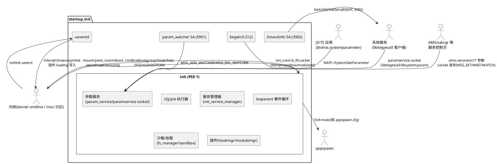

# 业务背景

## 应用定位

### 核心职责
startup_init 部件（`bundle.json` 部件名 `init`，子系统 `startup`）提供 OpenHarmony 内核加载后的第一个用户态进程——init（PID 1），职责覆盖"内核就绪"到"第一个应用启动"之间的系统引导全过程：

- 解析启动配置脚本（`*.cfg`、`*.para`、`*.group.cfg`），按 job 顺序执行启动命令（`services/init/init_config.c`、`services/init/standard/init_jobs.c`）；
- fork 并监管原生系统服务进程，为其设置 uid/gid/caps/secon/seccomp（`services/init/init_service_manager.c`、`services/init/init_common_service.c`）；
- 运行系统参数（syspara）服务：基于 `/dev/unix/socket/paramservice` 本地 socket 的参数 get/set/wait/watch，及跨进程共享内存只读访问（`services/param/`）；
- 提供 ueventd 进程（设备热插拔 netlink 监听、设备节点与 `/dev/block/by-name` 符号链接创建、固件事件处理，`ueventd/`）；
- 构建 system/chipset 沙箱（namespace + pivot_root）并按服务粒度进入（`services/sandbox/sandbox.c`）；
- 生成并加载 seccomp 系统调用过滤策略（`services/modules/seccomp/`）；
- 提供 `begetctl` 调试命令行工具与 `libbegetutil`/`libsystemparam` 等 inner-kits，供其他子系统链接（`interfaces/innerkits/`）；
- 提供 DeviceInfo 系统能力（SA 3902，`device_info/`）与参数监听代理（param_watcher SA 3901，`services/param/watcher/`）。

本仓同时适配 mini/small（lite，`services/init/lite/`、`services/etc_lite/`）与 standard（Linux 内核，`services/init/standard/`）三类系统（`bundle.json` adapted_system_type: `["mini","small","standard"]`）。

### 职责边界（本组件不负责）
- **不孵化应用进程**：ArkTS/JS/native/CJ 应用及渲染进程由 startup_appspawn 部件孵化；init 只按 `appspawn.cfg` 等配置拉起 appspawn 服务本体。
- **不做 Binder/SA 服务端**：init 不注册 SystemAbility；SA 的按需拉起由 samgr（systemabilitymgr_samgr）经 init 提供的参数/socket 接口触发，SA 生命周期归 samgr 管理。
- **不管理内核设备驱动**：设备模型归 HDF（hdf_core）；ueventd 只消费内核 netlink uevent 并创建设备节点。
- **不负责 JS/TS API 实现**：`interfaces/kets/jskits` 只做 NAPI 封装转发到参数/设备信息接口，语言运行时归 arkcompiler。
- **不承担 SELinux 策略内容管理**：`*.te`、`parameter_contexts`、`file_contexts` 由 base/security/selinux_adapter 维护；本仓只在 `secon` 字段解析、`setexeccon`、参数标签加载处对接。
- **不做产品定制逻辑**：产品差异经 `/sys_prod`、`/chip_prod` 等组件化配置目录与特性开关（`begetd.gni` declare_args）注入，本仓不内置产品判断。
- **ueventd 与 init 是不同进程**：ueventd 代码在本仓，但以独立服务（`services/etc/ueventd.cfg`，ondemand）运行，不与 PID 1 共享进程上下文。

## 系统上下文

外部协作要点（均为 AF_UNIX 本地 socket，目录 `/dev/unix/socket`，见 `interfaces/innerkits/include/init_socket.h` 的 `OHOS_SOCKET_DIR`）：
- 参数服务 socket：`/dev/unix/socket/paramservice`（`services/param/include/param_utils.h` 的 `PIPE_NAME`/`CLIENT_PIPE_NAME`）；
- fd 代持 socket：`/dev/unix/socket/fd_holder`（`interfaces/innerkits/fd_holder/fd_holder_internal.h`）；
- 控制通道 socket：`/dev/unix/socket/init_control_fd`（`interfaces/innerkits/control_fd/control_fd.h`）；
- 服务预建 socket：init 在 fork 服务前按 cfg `socket` 字段创建并经环境变量 `OHOS_SOCKET_<name>` 传递（`services/init/init_service_socket.c`）。

## 核心输入

| 输入 | 来源 | 主要内容 | 触发时机 |
|---|---|---|---|
| cmdline | 内核 `/proc/cmdline` | `bootgroup`（默认 `device.boot.group`）、fstab 路径、hvb 使能（`ohos.boot.hvb.oem_swtype`）、`ohos.boot.mode` | `InitServiceSpace()`/`LoadRequiredFstab()` 启动早期读取 |
| misc 分区启动模式 | misc 预置数据 | `GetBootModeFromMisc()` 判定充电模式（`device.charge.group`）等 | `ReadConfig()` 分支选择 |
| 启动配置 `*.cfg` | `/etc/init.cfg` 及 `/system`、`/vendor`、`/chipset`、`/sys_prod`、`/chip_prod` 下 `etc/init` 目录 | `jobs`/`services`/`import` JSON 结构 | `SystemConfig()`→`ReadConfig()` |
| 分组配置 `*.group.cfg` | `/system/etc/<group>.cfg` | jobs/services/plugins/cmds 字符串数组 | `InitParseGroupCfg()` |
| 系统参数文件 `*.para`/`*.para.dac`/`ohos.para.size` | `/etc/param`、`/system/etc/param`、`/vendor/etc/param` 等 | 参数键值、DAC 规则、标签空间大小 | `InitLoadParamFiles()`/`LoadSpecialParam()` |
| fstab | cmdline 或 `/system/etc/fstab.required` | 必需分区挂载项（含 `hvb` flag） | 第一阶段 `MountRequiredPartitions()` |
| 参数 socket 消息 | libbegetutil/libsystemparam 客户端、param_watcher SA | `ParamMessage`（MSG_SET_PARAM/MSG_WAIT_PARAM/MSG_ADD_WATCHER/MSG_DEL_WATCHER/MSG_NOTIFY_PARAM/MSG_SAVE_PARAM） | 客户端调用 SystemSetParameter/WaitParameter/WatchParam 等 |
| 服务控制参数 | samgr/AMS/begetctl | `ohos.servicectrl.*`、`ohos.ctl.start|stop=`、`ohos.startup.powerctrl=` | 参数写入触发 trigger |
| 信号 | 子进程/内核 | SIGCHLD（服务退出回收）、SIGTERM（停机） | signalfd 任务 `SignalInit()` |
| netlink uevent | 内核 | add/change/remove 设备事件 | ueventd 主循环 `ProcessUevent()` |
| ueventd 配置 | `/etc/ueventd.config`、`/vendor/etc/ueventd.config`、`/vendor/etc/ueventd_factory.config` | 设备节点权限表（INI） | ueventd 启动 |
| control_fd 消息 | begetctl | ACTION_SANDBOX/ACTION_DUMP/ACTION_MODULEMGR/ACTION_APP_SPAWNTIME/ACTION_APP_SANDBOX | `InitControlFd()` 注册的 socket 服务 |

## 核心输出

| 输出 | 接收方 | 业务作用 |
|---|---|---|
| fork 出的系统服务进程 | 各子系统 | 携带配置的 uid/gid/gidTable/caps/seccomp/secon/cgroup/cpucore/环境变量运行；ondemand 服务获得预建 socket fd |
| 参数读写应答 `ParamResponseMessage` | 客户端库调用方 | get/set/wait 的结果与 `PARAM_CODE_*` 错误码（100..117 及 DAC/MAC 扩展码） |
| 参数变更通知 | param_watcher SA → 应用回调 | WatchParamCheck 注册的监听方收到新值 |
| `startup.service.ctl.<name>`/`.pid` 参数 | samgr、begetctl 等监控方 | 服务状态（SERVICE_STARTED/STOPPED/READY 等）与 pid 查询（`NotifyServiceChange()`） |
| `startup.uevent.<parameter>` 参数 | 存储管理等子系统 | 设备节点 added/removed 通知（`ueventd/standard/ueventd_parameter.c`） |
| persist 参数文件 `/data/service/el1/startup/parameters/persist_parameters` | 下次开机 `LoadPersistParams()` | 跨重启保留参数 |
| 设备节点与 `/dev/block/by-name/*` 链接 | 块设备使用者（存储、升级、挂载） | 分区按名访问 |
| 沙箱 namespace（system/chipset） | 被 sandbox:1 约束的服务、sub-init | 隔离挂载视图 |
| 重启动作（`ExecReboot("panic"/"reboot"/...)`） | 内核 | critical 服务超限、`ohos.startup.powerctrl` 参数、begetctl reboot 命令 |
| 日志/事件 | dmesg 或 hilog | `INIT_LOG*` 宏按模块输出；sysevent 插件上报 hisysevent（`services/modules/sysevent/init_events.yaml`） |
